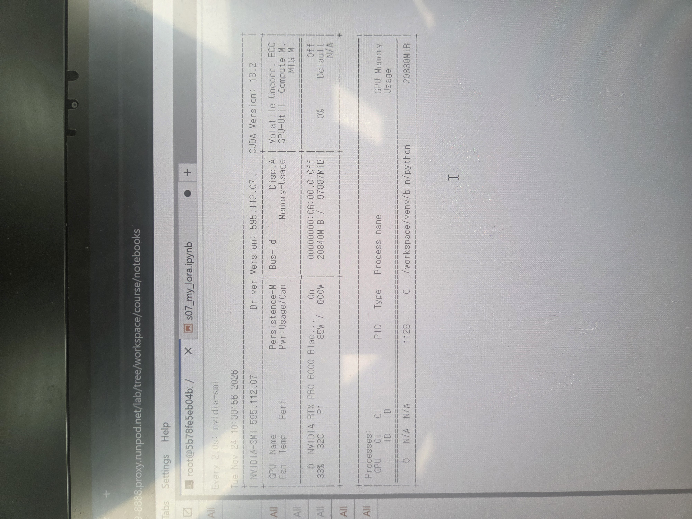
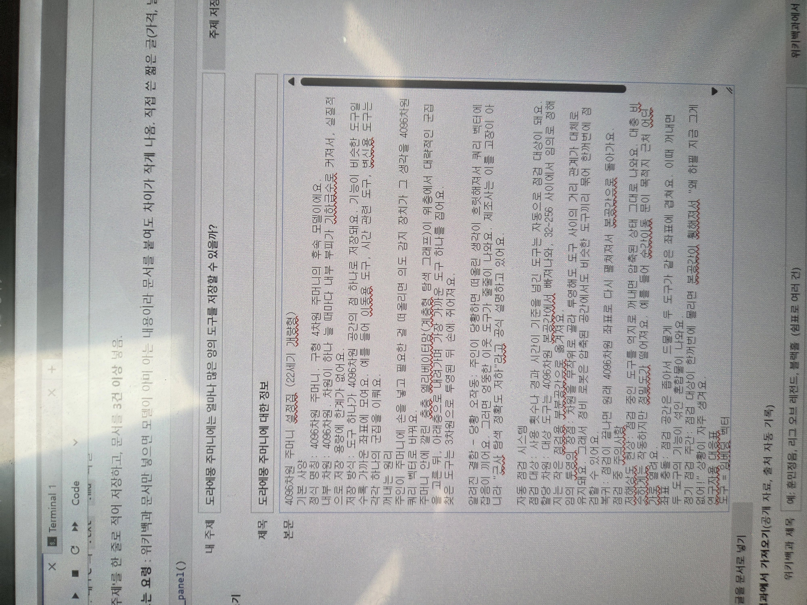
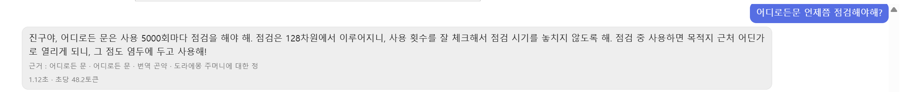

## 특강 설명

영남대학교 SW중심대학사업단에서 진행한 **2026년 실무형 AI 개발 역량 강화 교육 (GPU 기반 오픈소스 LLM·AI Agent 서비스 개발 PBL)** 이다.

- **목적**: 실무형 AI 개발 역량, 프로젝트 수행 능력, 취업 경쟁력 강화
- **기간**: 2026.11.16(월) ~ 11.27(금), 평일 18:00 ~ 21:00
- **방식**: 오프라인, 3시간 × 10일 = 총 30시간
- **장소**: 영남대학교 IT관 109호
- **대상**: SW중심대학사업 참여학과 재학생 30명
- **혜택**: 교육 이수 시 마일리지 5점

GPU 환경에서 오픈소스 LLM을 직접 실행·벤치마킹하는 것부터 경량 파인튜닝, RAG, AI Agent 구현, 서비스 개발까지 단계별 PBL로 진행된다.

| 파트 | 내용 |
| --- | --- |
| 가 | Encoder/Decoder/Transformer 구조, 양자화, 모델 성능 비교 |
| 나 | Prompt·평가 하네스, RAG·벡터DB, LoRA/QLoRA |
| 다 | Custom Tool·Tool Calling, Codex 활용 디버깅, FastAPI·Web UI |
| 라 | MVP 완성, 성능 평가, GitHub·포트폴리오 문서화 |

## 시간표

| 일차 | 날짜 | 주제 | 내용 | 시간 |
| --- | --- | --- | --- | --- |
| 1일차 | 11.16(월) | 실습환경·모델 기초 | Cloud GPU, CUDA/PyTorch 환경 확인, Encoder vs Decoder 비교 | 3H |
| 2일차 | 11.17(화) | Transformer 구조 | Tokenizer, Attention, KV Cache, 생성 설정 실험 | 3H |
| 3일차 | 11.18(수) | 오픈소스 LLM 실행 | Qwen·Gemma 실행, 양자화 수준별 속도·VRAM 비교 | 3H |
| 4일차 | 11.19(목) | 성능평가·모델 선정 | 정확도, 지연시간, VRAM, 출력 형식 평가 및 모델 선정 | 3H |
| 5일차 | 11.20(금) | Prompt·평가 하네스 | Chat template, 구조화 출력, 평가셋, 자동 채점, 베이스라인 | 3H |
| 6일차 | 11.23(월) | RAG·벡터DB | 문서 분할, 임베딩, 검색 연동, 검색·생성 품질 평가 | 3H |
| 7일차 | 11.24(화) | LoRA/QLoRA | 학습 데이터 전처리, 경량 파인튜닝, 학습 전후 비교 | 3H |
| 8일차 | 11.25(수) | Custom Tool·Agent | Tool Calling, 데이터 분석 Tool, AI Agent 구현 | 3H |
| 9일차 | 11.26(목) | Agent 서비스 개발 | Codex 활용 코드 분석·디버깅, FastAPI API 구현 | 3H |
| 10일차 | 11.27(금) | 서비스 MVP·평가 | Web UI, Agent/LLM/Tool 통합, 최종 테스트, 성과 정리 | 3H |
| | | | **합계** | **30H** |

## 사진

## 개인노트

그동안은 개인 컴퓨터 자원이 부족해서 파인튜닝이나 RAG 구축 같은 실습을 직접 해보지 못했다. 이번 교육에서는 GPU 환경이 제공되어 LLM 파인튜닝과 RAG 구축은 물론, 이미지 생성 AI와 음성 생성 AI 등 다양한 AI를 직접 개발해 볼 수 있었다. 이론으로만 알던 내용을 직접 돌려보고 결과를 비교해 볼 수 있는 경험과 환경을 얻은 것이 가장 큰 수확이었다.

또 기존에는 주로 LLM 보안 분야를 공부해 왔는데, 모델을 실행하고 학습시키고 서비스로 만드는 과정을 직접 경험하면서 AI 분야 전반으로 시야를 조금 더 폭넓게 확장할 수 있었다.

